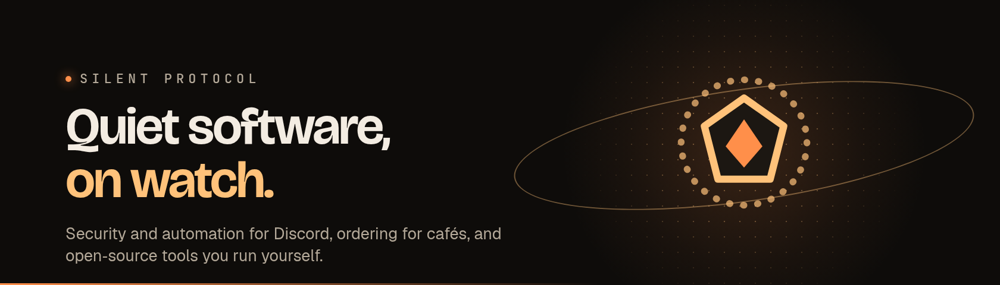

<p align="center">
  <a href="https://silentprotocol.top"><b>silentprotocol.top</b></a> &nbsp;·&nbsp;
  <a href="https://tabletap.biz.id"><b>TableTap</b></a> &nbsp;·&nbsp;
  <a href="https://github.com/Silent-Protocol-Inc/folio"><b>Folio</b></a> &nbsp;·&nbsp;
  <a href="mailto:team@silentprotocol.top"><b>team@silentprotocol.top</b></a>
</p>

We build software that does its job without asking for attention: it keeps a Discord server safe, takes a café's orders, or tracks your money on a server you own.

## What we make

| Product | What it does |
| --- | --- |
| **[Silent Protocol for Discord](https://silentprotocol.top)** | Keeps Discord servers safe and automated with AI-driven defenses and dashboards. |
| **[TableTap](https://tabletap.biz.id)** | QR table ordering and QRIS checkout for cafés and restaurants in Indonesia. |
| **[Folio](https://github.com/Silent-Protocol-Inc/folio)** | Self-hosted personal finance: transactions, budgets, debts, subscriptions, goals and investments. One-line install, open source. |
| **[Silent Authenticator](https://github.com/Silent-Protocol-Inc/Silent-Authenticator)** | Authentication for secure, seamless and reliable identity verification. |
| **[Silent NEXUS Agents](https://github.com/Silent-Protocol-Inc/Silent-Nexus-Agents)** | A model-agnostic AI agent harness: interactive CLI workflows, scoped memory, planning, subagents and provider integrations. |

## Open source

Folio is open source under the Apache-2.0 licence. Install it on Linux, macOS or Android (Termux) with one command; the [README](https://github.com/Silent-Protocol-Inc/folio#quick-start) has the Windows one-liner:

```sh
curl -fsSL https://raw.githubusercontent.com/Silent-Protocol-Inc/folio/main/install.sh | bash
```

Issues and pull requests are welcome in each repository. Security reports go to **team@silentprotocol.top**, not public issues.
